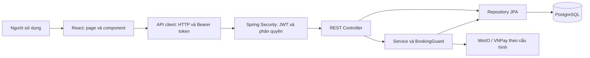

# BÁO CÁO THUYẾT TRÌNH WEBSITE QUẢN LÝ SÂN BÓNG — SÂN BÓNG PRO

**Ngày tổng hợp:** 13/10/2026. **Căn cứ:** source hiện tại, kết quả kiểm thử và các lần kiểm tra thực tế trong dự án.

Tài liệu này giải thích hệ thống hiện có và các phần đã sửa, bổ sung trong quá trình hoàn thiện. Không phải bảng xác nhận tác giả từng dòng code: khi trình bày cá nhân, chỉ nhận những phần đúng với phân công thực tế của bạn/nhóm. Các đoạn code dưới đây được trích hoặc rút gọn từ source để giải thích; không chứa credentials.

## 1. Giới thiệu đề tài

Website hỗ trợ khách hàng tìm sân bóng, xem lịch trống, gửi yêu cầu đặt sân và theo dõi đơn. Chủ sân và nhân viên dùng hệ thống để quản lý sân, khung giờ, bảng giá, đơn đặt, thanh toán và báo cáo.

Vấn đề giải quyết là việc đặt sân qua điện thoại hoặc ghi chép rời rạc dễ dẫn đến trùng lịch, nhầm giá, khó theo dõi thanh toán và thiếu giới hạn quyền của nhân viên. Dự án đưa các thông tin này về một hệ thống chung, có API và cơ sở dữ liệu.

**Cách giới thiệu:** “Đề tài của nhóm em là website Quản Lý Sân Bóng, với tên giao diện SÂN BÓNG PRO. Hệ thống phục vụ cả khách đặt sân và người vận hành sân. Phần trọng tâm là quản lý lịch đặt chính xác, phân quyền phù hợp và đồng bộ dữ liệu giữa giao diện với Backend.”

## 2. Công nghệ và cấu trúc

| Thành phần | Công nghệ trong source | Vai trò |
|---|---|---|
| Frontend | React 18, Vite, CSS/Tailwind | Hiển thị giao diện, quản lý trạng thái form, gọi API |
| Backend | Spring Boot 2.7, Java; pom đặt Java 11 | Cung cấp REST API và xử lý nghiệp vụ |
| Truy cập dữ liệu | Spring Data JPA, Hibernate | Ánh xạ Entity và truy vấn Repository |
| Database chính | PostgreSQL | Lưu người dùng, sân, lịch đặt, giá và thanh toán |
| Bảo mật | Spring Security, BCrypt, JWT | Kiểm tra tài khoản, token và quyền truy cập |
| Ảnh/file | MinIO | Lưu và truy xuất file theo cấu hình dịch vụ |
| Thanh toán | Tiền mặt, chuyển khoản, mã tích hợp VNPay | Các phương thức được khai báo và xử lý trong hệ thống |
| Kiểm thử | JUnit/Spring Boot Test, H2, Node test, ESLint | Kiểm tra nghiệp vụ, API và Frontend |
| Quản lý source | Hai repository GitLab riêng | Backend và Frontend có branch/commit độc lập |

Backend nằm ở thư mục gốc, Frontend ở `fe/`. Backend có `controller`, `service`, `repository`, `entity`, `dto`, `security`, `config`, `exception`. Frontend có `pages`, `components`, `api`, `utils`.

Source sử dụng phân lớp nhưng một phần nghiệp vụ vẫn nằm trong Controller; không nên mô tả rằng toàn bộ nghiệp vụ đã tách hết sang Service. Các service như `BookingGuard`, `VNPayService`, `MinioService` gom những xử lý dùng chung hoặc liên quan dịch vụ ngoài. Điều hướng Frontend hiện do `App.jsx` quản lý bằng History API và bảng quyền, không phải một luồng React Router đã được xác minh.



## 3. Các nhóm người dùng và chức năng

| Người dùng | Chức năng chính trong source |
|---|---|
| Khách chưa đăng nhập | Xem sân, tìm/lọc/sắp xếp, xem chi tiết và lịch trống, đăng ký/đăng nhập |
| `KHACH_HANG` | Đặt sân, xem lịch sử, xem thông tin hóa đơn, hủy theo điều kiện, quản lý hồ sơ và sân yêu thích |
| `NHAN_VIEN_PAGE` | Xem và xử lý yêu cầu đặt sân, theo dõi lịch trong cụm được phân công |
| `NHAN_VIEN_SAN` | Công việc tại sân: lịch, đặt tại quầy, ghi nhận thanh toán và check-in theo quyền |
| `ADMIN` | Quản lý sân/cụm sân, khung giờ/giá, khách hàng/nhân viên, thanh toán, dashboard và báo cáo |

Đây là phạm vi chức năng tồn tại trong source. Các chức năng liên quan dịch vụ ngoài không đồng nghĩa đã nghiệm thu trên production.

## 4. Những phần đã hoàn thiện và sửa trong quá trình làm dự án

| Phần việc | Kết quả và cách triển khai |
|---|---|
| Trang chủ | Giữ ảnh và chiều cao Hero; đưa form tìm sân xuống nền trắng; đưa sort bên dưới form; giữ API, lọc và yêu thích |
| Login/Register | `AuthLayout` dùng chung, form trắng giữa nền sân vận động đỏ; responsive; giữ đủ trường và logic xác thực |
| Tìm sân | Dùng dữ liệu API thật; tìm tiếng Việt có/không dấu, lọc cụm/loại sân, sort tên/giá |
| Sân yêu thích | Component card kết hợp API có xác thực; khách chưa đăng nhập được hướng dẫn đăng nhập |
| Nghiệp vụ đặt sân | Kiểm tra sân hoạt động, ngày/giờ hợp lệ, khoảng giờ giao nhau, giữ chỗ và khóa bản ghi |
| Quản trị | Sửa và kiểm tra CRUD sân, khung giờ, bảng giá cùng validation và các ràng buộc liên quan dữ liệu cũ |
| Phạm vi nhân viên | Backend kiểm tra cụm được phân công trước khi xử lý đơn; không chỉ ẩn nút ở FE |
| Check-in | Đơn đã xác nhận; từ 30 phút trước giờ bắt đầu đến giờ kết thúc; có kiểm tra role và cụm sân |
| JWT local | Sinh key mật mã trong file local bị Git bỏ qua; tách lỗi thiếu key, key ngắn và expiration không hợp lệ |
| Đồng bộ schema | Migration thêm cột `can_xu_ly_hoan_tien`; backup/kiểm tra dữ liệu trước và sau; giữ `ddl-auto=validate` |
| Kiểm thử | Chạy test BE/FE, build và lint FE; kiểm tra giao diện trên trình duyệt ở nhiều kích thước |
| Rà soát Git | Kiểm tra hai repo, secrets và lịch sử; dừng push main khi phát hiện credentials trong lịch sử Backend |

Các lần sửa UI, JWT và migration gần đây không thay đổi logic VNPay. Không dùng ảnh minh họa sân vận động để khẳng định đó là ảnh của sân có thể đặt: ảnh Hero/Auth là artwork thương hiệu; ảnh card phụ thuộc dữ liệu sân từ API.

## 5. Thiết kế dữ liệu

| Entity | Thông tin và quan hệ chính |
|---|---|
| `NguoiDung` | Tài khoản, mật khẩu đã băm, vai trò, trạng thái; nhân viên có cụm được phân công |
| `CumSan` | Cụm sân; liên quan nhiều sân và nhân viên |
| `San` | Tên, loại, trạng thái, cụm sân và thông tin hiển thị |
| `KhungGio` | Giờ bắt đầu và kết thúc |
| `GiaSan` | Giá theo sân, khung giờ, loại ngày; Entity khai báo unique cho tổ hợp này |
| `DatSan` | Khách hàng, sân, khung giờ, ngày, giá lúc đặt, trạng thái và hạn giữ chỗ |
| `ThanhToan` | Đơn đặt, số tiền, phương thức, trạng thái, mã tham chiếu và cờ cần xử lý hoàn tiền |
| `YeuThich` | Liên kết khách hàng với sân đã lưu |

Quan hệ quan trọng: một sân thuộc một cụm; một đơn đặt tham chiếu khách hàng/sân/khung giờ; một đơn đặt có danh sách thanh toán. Thông tin hóa đơn được API trả từ nghiệp vụ đặt/thanh toán; không trình bày rằng dự án có Entity `HoaDon` riêng khi chưa có trong source.

**Điểm nên giải thích:** `DatSan.gia` là snapshot giá. Backend gán `datSan.setGia(giaSan.getGia())` lúc tạo đơn. Khi quản trị sửa bảng giá cho các lần đặt sau, đơn cũ vẫn giữ giá đã lưu. Tiền được biểu diễn bằng `BigDecimal`, giúp tránh dùng số thực nhị phân cho các phép tính tiền trong Backend.

## 6. Code Frontend hoạt động như thế nào?

### 6.1. Component và trạng thái

Page quản lý dữ liệu bằng React state. Form dùng controlled input: `value` lấy từ state và `onChange` cập nhật state. Các biến loading/error điều khiển nút disabled và thông báo. `AuthLayout` chỉ phụ trách khung giao diện chung; xử lý đăng nhập/đăng ký vẫn ở `GuestPages.jsx`.

`Brand` có tùy chọn accent cho chữ PRO ở trang xác thực. Khi không bật tùy chọn, markup mặc định được kiểm tra là giữ nguyên cho những trang khác.

### 6.2. Gọi API đặt sân

Ví dụ rút gọn từ `fe/src/api/datSanApi.js`:

```js
async taoDatSan({ sanId, khungGioId, ngayDat, phuongThucThanhToan }) {
  const res = await http.post('/api/dat-san', {
    sanId, khungGioId, ngayDat, phuongThucThanhToan
  });
  return res.data;
}
```

Giao diện gửi ID/ngày/phương thức. Backend kiểm tra lại và lấy giá từ bảng giá; không chỉ tin thông tin hiển thị trên trình duyệt. `http.js` gom base URL, header JWT, đọc JSON và xử lý lỗi để các page không lặp toàn bộ code HTTP.

### 6.3. Ghi nhớ đăng nhập

Phần chính từ `http.js`:

```js
const storage = remember ? localStorage : sessionStorage;
storage.setItem('phien', JSON.stringify(value));
const token = value?.token || value?.accessToken;
if (token) storage.setItem('token', token);
```

Code đầy đủ còn xóa phiên ở storage còn lại và phát sự kiện đồng bộ UI. “Ghi nhớ” lưu phiên/token, không phải lưu mật khẩu người dùng. Client đính kèm `Authorization: Bearer ...`; lỗi 401 với phiên đang có sẽ xóa phiên, lỗi 403 không tự đăng xuất. Lưu token trong browser storage vẫn cần kiểm soát XSS; không khẳng định hệ thống đã dùng cookie HttpOnly.

### 6.4. Tìm kiếm và chống gửi lặp

`courtSearch.js` chuẩn hóa chuỗi bằng Unicode NFD, bỏ dấu, đổi đ/Đ, chuyển chữ thường; sau đó lọc tên/cụm/loại sân và sắp xếp. Đây là tìm kiếm trên danh sách đã tải về, không nên nói là toàn bộ việc lọc đã được query trực tiếp từ PostgreSQL.

`useExclusiveAction` dùng `useRef` và hàm guard để ngăn nhiều lần submit đồng thời trong một UI. Đây là lớp hỗ trợ trải nghiệm; an toàn nghiệp vụ vẫn cần kiểm tra và transaction phía Backend.

## 7. Backend xác thực và phân quyền ra sao?

Luồng đăng nhập: FE gửi tài khoản/mật khẩu → `AuthController` tìm người dùng → BCrypt kiểm tra mật khẩu → kiểm tra trạng thái tài khoản → tạo JWT → trả token cùng thông tin role → FE lưu phiên và chuyển trang theo role.

Ví dụ cấu hình thực tế:

```java
@Bean
public PasswordEncoder passwordEncoder() {
    return new BCryptPasswordEncoder();
}
```

JWT được ký bằng HS256. `JwtTokenProvider` yêu cầu secret ít nhất 32 byte UTF-8 và expiration dương; không có key production mặc định. `JwtAuthFilter` lấy Bearer token, kiểm tra token rồi tải lại tài khoản để kiểm tra khóa/trạng thái và lấy quyền hiện tại. Vì vậy không chỉ tin role mà trình duyệt tự gửi.

`SecurityConfig` cấu hình stateless và quyền API; `@PreAuthorize` tiếp tục bảo vệ method. Chặn route FE chỉ là hỗ trợ UI, không thay thế kiểm tra ở BE. API admin yêu cầu ADMIN; tạo đơn khách hàng yêu cầu KHACH_HANG. Sân/lịch public được truy cập theo mapping công khai hiện tại.

## 8. Chống đặt trùng được code như thế nào?

Đây là phần kỹ thuật nên dành nhiều thời gian giải thích nhất.

1. Request tạo đơn đi vào method có `@Transactional`.
2. Backend lấy sân và khung giờ bằng truy vấn có khóa.
3. Kiểm tra sân đang hoạt động và thời gian còn hợp lệ.
4. Kiểm tra các đơn cùng sân/ngày có đang chiếm lịch không.
5. Nếu khoảng giờ giao nhau, trả lỗi 409.
6. Nếu hợp lệ, lưu đơn cùng snapshot giá và trạng thái phù hợp.

Repository của sân có khai báo:

```java
@Lock(LockModeType.PESSIMISTIC_WRITE)
@Query("select s from San s where s.id = :id")
Optional<San> findLockedById(@Param("id") Long id);
```

Khóa giúp các request cùng đặt một sân không đồng thời đọc thấy lịch trống rồi cùng ghi đơn. `BookingGuard` còn dùng cùng thứ tự khóa sân/đơn cho các writer liên quan. Không nên tuyên bố lớp này xử lý mọi race condition của toàn bộ CRUD hệ thống: phạm vi đã kiểm tra tập trung vào luồng booking.

Điều kiện giao nhau trong `BookingGuard`:

```java
return a.getGioBatDau().isBefore(b.getGioKetThuc())
    && b.getGioBatDau().isBefore(a.getGioKetThuc());
```

Ví dụ 18:00–19:00 và 18:30–19:30 bị trùng; 18:00–19:00 và 19:00–20:00 không trùng. So sánh trước thời điểm kết thúc cho phép hai khoảng sát nhau.

Giữ chỗ online có thời hạn 15 phút theo hằng số hiện tại. `BookingGuard.occupies()` chỉ coi giữ chỗ chưa hết hạn là chiếm lịch. Các đơn chờ xác nhận/đã xác nhận/đã check-in và trạng thái hoàn thành được xét theo code của guard. Trạng thái hủy không chiếm chỗ. Không cần khẳng định có cron xóa đơn giữ chỗ khi chưa chứng minh: lịch trống phụ thuộc kiểm tra hiệu lực của giữ chỗ.

## 9. Phạm vi nhân viên và check-in

`BookingGuard.requireStaffScope()` cho ADMIN truy cập; nhân viên cần có cùng ID cụm với sân. Nếu khác cụm trả 403. Đây là lý do một nhân viên không thể xử lý đơn cụm khác chỉ bằng cách đổi ID trong URL.

Điều kiện thời gian từ `NhanVienDatSanController`:

```java
if (now.isBefore(start.minusMinutes(30)) || now.isAfter(end)) {
    throw new ResponseStatusException(HttpStatus.CONFLICT,
        "Chỉ check-in từ 30 phút trước giờ bắt đầu đến giờ kết thúc");
}
```

Method yêu cầu role ADMIN hoặc NHAN_VIEN_SAN, kiểm tra quyền với đơn và yêu cầu đơn `DA_XAC_NHAN`. Khi đơn đã `DA_CHECKIN`, gọi lại trả dữ liệu hiện tại thay vì chuyển trạng thái lặp. Theo code check-in hiện tại, không nên tự bổ sung lời khẳng định “bắt buộc đã thu đủ tiền” nếu chỉ trình bày method này, vì điều kiện đó không nằm trong đoạn kiểm tra trên.

## 10. Thanh toán và migration đã thực hiện

Source có tiền mặt, chuyển khoản và các endpoint VNPay. Trạng thái thanh toán riêng là `CHO_THANH_TOAN`, `THANH_CONG`, `THAT_BAI`; trạng thái đặt sân là một bộ enum khác. “Đã xác nhận đơn” không tự động đồng nghĩa “đã thanh toán thành công”.

Code VNPay có xử lý chữ ký/kết quả, callback và những điều kiện liên quan đơn/cờ xử lý hoàn tiền. Phần sửa UI, cấu hình JWT và migration gần đây giữ nguyên logic này. Chưa nghiệm thu giao dịch VNPay thật; không trình bày như thanh toán production đã thành công.

Lỗi PostgreSQL thực tế là Entity `ThanhToan` đã có boolean `canXuLyHoanTien`, nhưng bảng chưa có cột tương ứng. Đã kiểm tra đúng `ra99_n2.public`, sao lưu dữ liệu liên quan, chỉ chạy file đã được chủ dự án duyệt:

```sql
ALTER TABLE public.thanh_toan
    ADD COLUMN IF NOT EXISTS can_xu_ly_hoan_tien
    BOOLEAN NOT NULL DEFAULT FALSE;
```

File đầy đủ còn có BEGIN/COMMIT và timeout. Không DROP TABLE, không sửa số tiền hoặc trạng thái thanh toán. Sau migration, 3 thanh toán và dữ liệu đặt sân liên quan giữ nguyên; giá trị mới là false. Backend giữ `ddl-auto=validate`, tức kiểm tra cấu trúc thay vì tự đổi schema.

Backup là dữ liệu CSV cùng metadata, không phải dump toàn database. Đã thử khôi phục trên H2 PostgreSQL-mode, đối chiếu 54 giá trị và liên kết của 3 thanh toán/3 đơn liên quan; chưa thử phục hồi một PostgreSQL đầy đủ từ backup này.

## 11. Bảng API để trình bày

| Chức năng | API thực tế |
|---|---|
| Đăng nhập / đăng ký | POST `/api/auth/dang-nhap`, POST `/api/auth/dang-ky` |
| Danh sách sân | GET `/api/san` |
| Lịch trống | GET `/api/san/{sanId}/lich-trong` |
| Tạo đơn / lịch sử | POST `/api/dat-san`, GET `/api/dat-san/cua-toi` |
| Hủy đơn | PUT `/api/dat-san/{id}/huy` |
| Duyệt / từ chối | PUT `/api/nhan-vien/dat-san/{id}/duyet`, `/{id}/tu-choi` |
| Check-in | PUT `/api/nhan-vien/dat-san/{id}/checkin` |
| Yêu thích | GET `/api/yeu-thich`, POST/DELETE `/api/yeu-thich/{sanId}` |
| Hồ sơ | GET/PUT `/api/nguoi-dung/me` |
| Dashboard / doanh thu | GET `/api/admin/dashboard`, `/api/admin/doanh-thu` |

API trả dữ liệu/DTO cho FE. Không đưa token, mật khẩu, file .env hoặc dữ liệu thanh toán cá nhân lên slide.

## 12. Kiểm thử và trạng thái hiện tại

| Nội dung | Kết quả đã xác minh |
|---|---|
| Backend build | Maven verify thành công, tạo JAR |
| Backend test | 41 bài test pass; có kiểm tra nghiệp vụ/API trên H2 và mock dịch vụ theo test |
| Frontend test | 19 bài test pass |
| Frontend lint/build | CLI ESLint và Vite local pass |
| UI | Kiểm tra Desktop/Tablet/Mobile; Login/Register ở 320–1440px, form dài cuộn tự nhiên |
| PostgreSQL migration | Đã chạy đúng SQL được duyệt; kiểm tra cột và bảo toàn dữ liệu |
| Startup PostgreSQL sau migration | Hibernate validate đã qua; ứng dụng dừng vì thiếu `MINIO_ENDPOINT` |
| GitLab feature branches | Đã có source trên các nhánh công việc trước đó |
| Push mới lên main | Chưa thực hiện: phát hiện secrets trong lịch sử Backend và dừng theo yêu cầu |
| GitLab CI/CD | Chưa có kết quả remote CI được xác minh để báo pass |

Một lỗi công cụ hiện tại: `npm run` không chạy ổn vì npm global thiếu `walk-up-path`; các CLI FE local đã chạy trực tiếp thành công. Không nên nói rằng npm global đã được sửa.

Những hạn chế cần nói trung thực: cấu hình MinIO còn thiếu để startup thực hoàn tất; giao dịch VNPay thật, upload MinIO thật và export trong môi trường thực chưa được nghiệm thu đầy đủ. Credentials cũ trong lịch sử Git cần được thu hồi/đổi và có phương án xử lý với chủ repository. Build/test pass không đồng nghĩa đã triển khai production an toàn.

## 13. Kịch bản demo gợi ý

**Chỉ thực hiện demo nghiệp vụ khi Backend/dịch vụ đã chạy hợp lệ trên môi trường demo được phép.** Hiện tại có thể trình bày giao diện và ảnh đã kiểm tra; không giả vờ API PostgreSQL đang hoạt động khi startup còn lỗi MinIO.

1. Trang chủ: giải thích Hero, form tìm sân phía dưới, tìm không dấu, lọc loại/cụm và sort.
2. Chuyển Login ↔ Register: form dùng chung, đủ trường, toggle mật khẩu và thông báo validation.
3. Khách hàng: chi tiết sân, lịch trống và gửi yêu cầu đặt; sau đó mở lịch sử.
4. Nhân viên: duyệt yêu cầu đúng cụm, giải thích giới hạn quyền và check-in 30 phút.
5. Admin: quản lý khung giờ/giá và dashboard từ dữ liệu hệ thống.
6. Mở code `BookingGuard` và `SanRepository` để minh họa chống trùng.

Dùng tài khoản demo được phép, tránh đặt/thanh toán thật. Mở code và dữ liệu đã che thông tin riêng tư; tuyệt đối không mở Run Configuration chứa credentials trước lớp.

## 14. Câu hỏi giảng viên và cách trả lời

**Vì sao dùng JWT?** API stateless; FE gửi Bearer token cho mỗi request. BE kiểm tra token và tải lại người dùng/quyền. JWT không thay thế việc bảo vệ secret hoặc xử lý XSS.

**Vì sao không chỉ ẩn nút quản trị?** Người dùng có thể tự gọi API. Vì vậy BE kiểm tra role bằng SecurityConfig/PreAuthorize và kiểm tra cụm sân bằng BookingGuard.

**Hai người đặt cùng lúc thì sao?** Transaction và khóa pessimistic trên cùng sân làm các request liên quan tuần tự kiểm tra; guard kiểm tra giờ giao nhau trước khi lưu. Phạm vi đã kiểm thử là luồng booking, không khẳng định toàn hệ thống hết mọi race condition.

**Tại sao cần snapshot giá?** Đơn phải giữ giá tại thời điểm đặt, không thay đổi khi bảng giá phục vụ lần đặt mới được chỉnh.

**Hủy đơn có làm sai báo cáo?** Trạng thái đặt và trạng thái thanh toán được xử lý riêng theo các nhánh nghiệp vụ; đơn hủy không chiếm lịch. Trường hợp đã thu tiền cần đánh dấu xử lý hoàn tiền, không có nghĩa hệ thống tự chuyển tiền hoàn ngay.

**Báo cáo doanh thu có phải số liệu giả?** UI dashboard nhận dữ liệu API. Các test có fixture/mocks trong môi trường cô lập; không dùng kết quả fixture để khẳng định doanh thu production.

**Cờ hoàn tiền dùng làm gì?** Thể hiện thanh toán cần được xử lý hoàn tiền theo luồng hiện có; boolean này không phải chức năng hoàn tiền tự động hoàn chỉnh.

**Tại sao giữ ddl-auto=validate?** Để phát hiện chênh lệch Entity/schema và đưa thay đổi cấu trúc qua SQL được duyệt, thay vì cho Hibernate tự đổi database thật.

**Dự án đã hoàn thiện hết chưa?** Phần source và các kiểm thử đã có kết quả cụ thể; startup thực còn vướng MinIO, VNPay thật và các dịch vụ ngoài cần nghiệm thu thêm, push main đang dừng vì lịch sử có secrets.

## 15. Các file nên mở khi giải thích code

| Nội dung | File |
|---|---|
| Điều hướng và phân trang theo quyền | `fe/src/App.jsx` |
| Form Login/Register | `fe/src/pages/GuestPages.jsx`, `fe/src/components/AuthLayout.jsx` |
| API và lưu phiên | `fe/src/api/authApi.js`, `fe/src/api/http.js` |
| Tìm/sort sân | `fe/src/pages/PremiumHomePage.jsx`, `fe/src/utils/courtSearch.js` |
| API đăng nhập | `src/main/java/com/example/becicd/controller/AuthController.java` |
| Bảo mật | `config/SecurityConfig.java`, `security/JwtTokenProvider.java`, `security/JwtAuthFilter.java` dưới package BE |
| Chống trùng | `service/BookingGuard.java`, `repository/SanRepository.java`, `controller/DatSanController.java` |
| Check-in và phạm vi nhân viên | `controller/NhanVienDatSanController.java` |
| Giá và thanh toán | `entity/DatSan.java`, `entity/GiaSan.java`, `entity/ThanhToan.java` |
| Kiểm thử | `src/test/java/com/example/becicd/SystemHttpIntegrationTest.java`, `RefundFlagMigrationTest.java`, `fe/tests/` |

Source đầy đủ nằm tại `D:\Năm 3\RaiWay99\QuanLiSanBong`. Bảng này là đường dẫn tương đối để tìm trong IDE; không cần đọc cả file dài trước lớp, chỉ chọn đoạn thể hiện ý đang giải thích.
